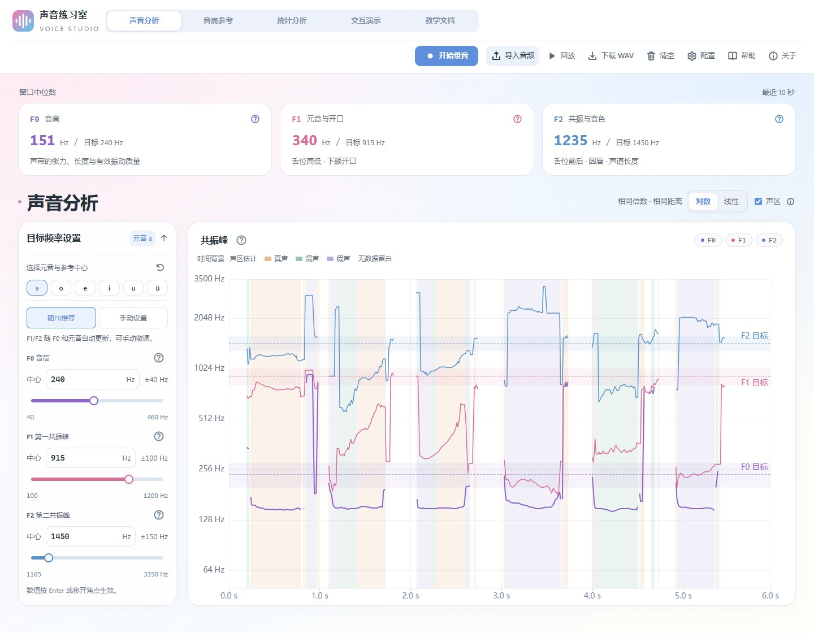
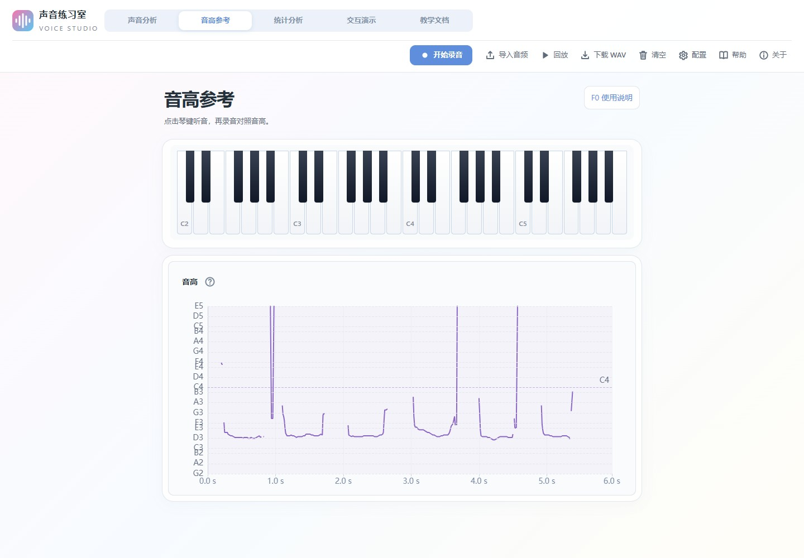
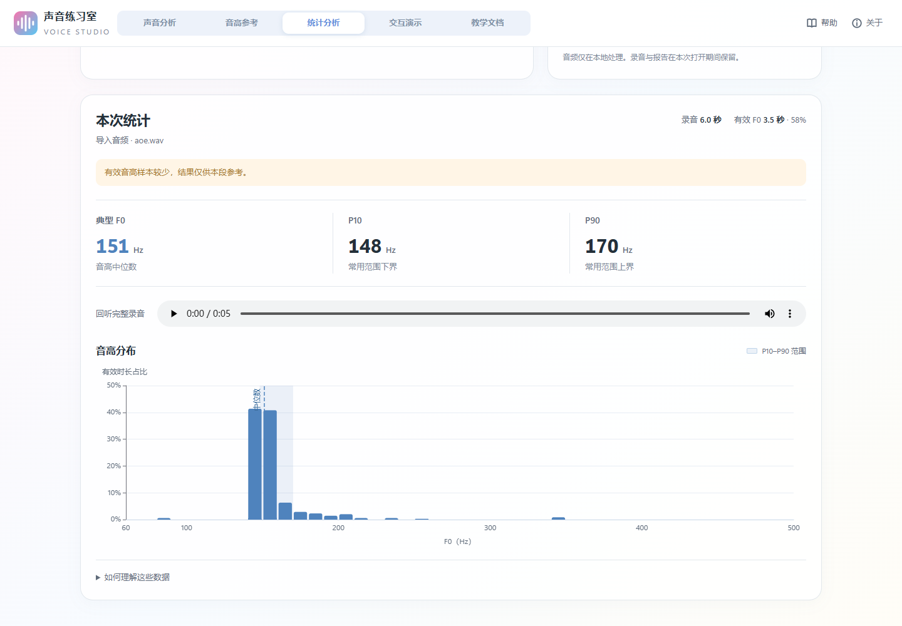

# 声音练习室

为伪音练习而设计：实时分析语音的音高与共振峰，并整合教学文档与交互式可视化。

## 来源与致谢

本项目基于 [JPs-git/voice-builder](https://github.com/JPs-git/voice-builder) 二次开发，并整合了 [あおぎ葵 / Aoi](https://space.bilibili.com/942770) 的 [练习手册](https://mtf-voice-training.vercel.app/)。感谢原作者提供的代码与文档。

本版对手册作了少量修订、校注与图示调整，教学页已标注，并保留原作者署名与原站链接。

## 主要功能

[开始练习](https://emmm1e3m.github.io/voice_tuning/)

| 页面 | 功能 |
| --- | --- |
| 声音分析 | 录音或导入音频，查看 F0/F1/F2 曲线、目标带与声区估计，支持回放和下载 WAV。 |
| 音高参考 | 用钢琴听参考音，对照音名曲线练习。 |
| 统计分析 | 录制或导入最长 60 秒的片段，查看 F0 中位数、P10/P90 与音高分布，提供中英朗读材料。 |
| 交互演示 | 调节六个发声部位，联动观察声道结构、元音位置与频谱。 |
| 教学文档 | 阅读上述手册的原理与练习，包含重绘插图和 Praat 截图，支持分享章节地址。 |

支持六个元音的目标设置，可随 F0 推荐或手动调整共振峰；「配置」中可调整分析参数、音频保留时长及个人声区校准。

## 界面预览

声音分析、音高参考与统计报告使用仓库自带的 `aoe.wav` 示例音频。

### 声音分析



<details>
<summary>更多界面：音高参考、统计、交互、教学与手机布局</summary>

### 音高参考



### 统计分析



### 交互演示


### 教学文档


### 配置与手机布局


</details>

## 本地运行

安装 Node.js（推荐 22）后，双击「启动练习器.cmd」，或在仓库根目录运行：

```powershell
cd downloads/voice.starbow.top/source
npm ci
npm run dev -- --host 127.0.0.1
```

录音需允许麦克风访问，并使用 HTTPS 或 localhost。

## 数据保存

音频在浏览器内处理。主分析默认保留最近 10 秒，可设为 5–120 秒；下载 WAV 保存当前窗口。统计页独立保留最长 60 秒的完整片段，切页可保留草稿和报告，刷新后清除。配置、目标与校准保存在当前浏览器中。

当前 Pages 构建默认关闭使用统计；自行部署的配置见[统计说明](downloads/voice.starbow.top/source/docs/analytics.md)。

## 开发与发布

在源码目录执行：

```powershell
npm test -- --testTimeout=15000
npx tsc --noEmit
npm run build -- --base=/voice_tuning/
```

推送 `main` 后，[GitHub Actions](https://github.com/emmm1e3m/voice_tuning/actions/workflows/pages.yml) 自动验证并部署 Pages。

[使用说明](docs/使用说明.md) · [启动说明](scripts/启动说明.md) · [源码说明](downloads/voice.starbow.top/source/README.md)
